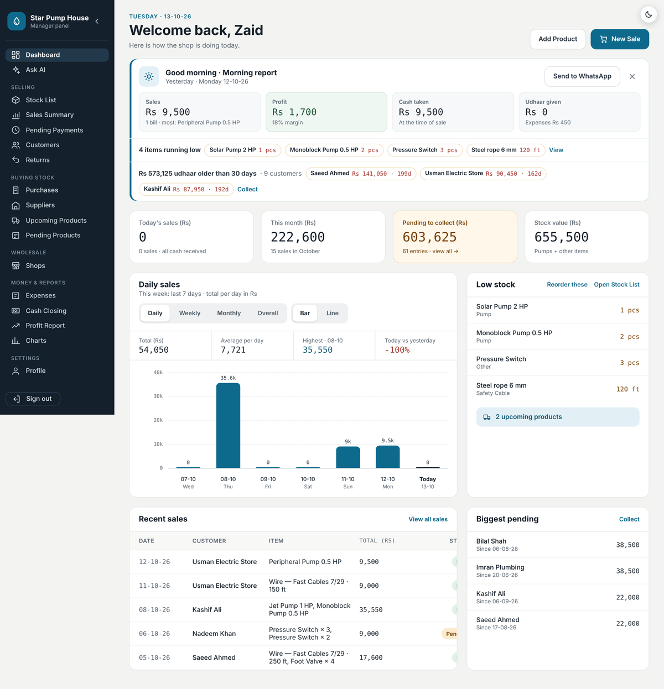
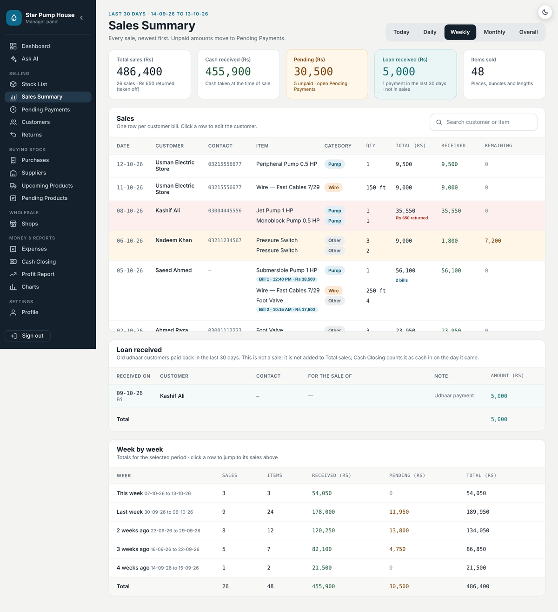
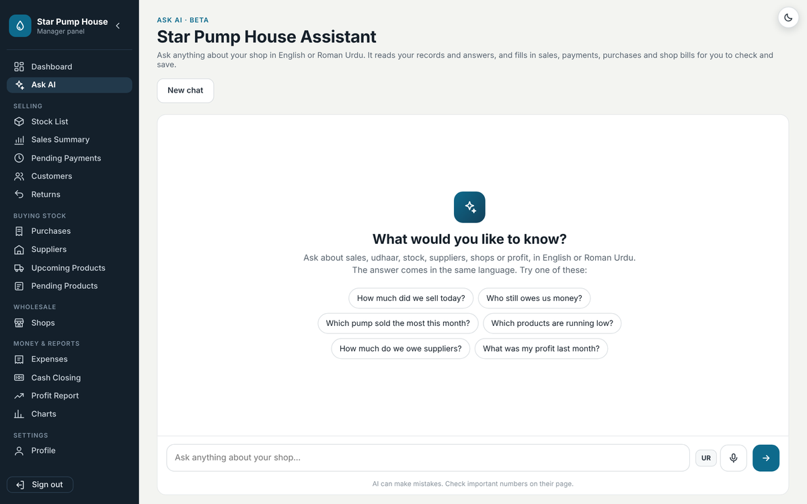
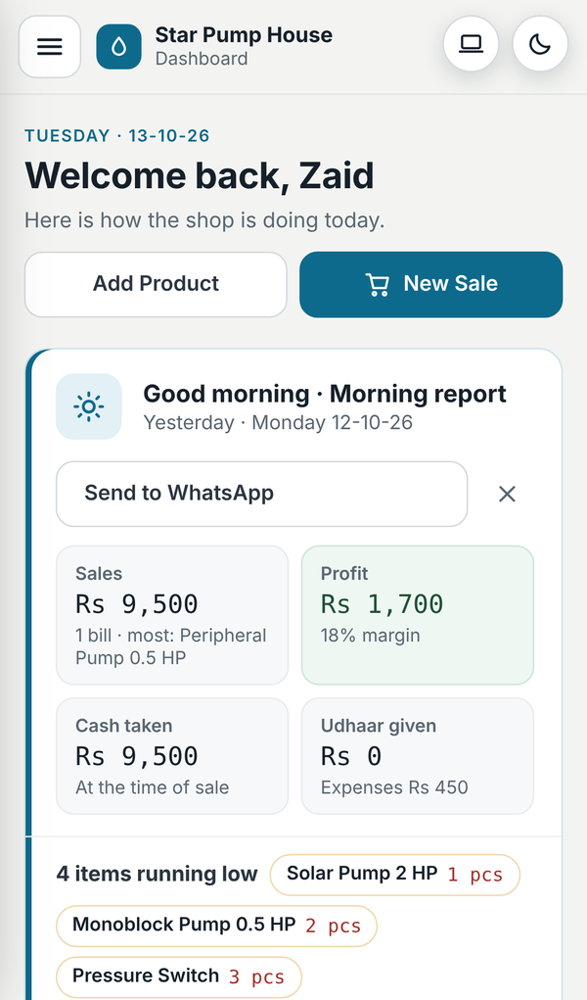

# Star Pump House: Shop Manager

A free, web-based shop management system for **Star Pump House**, a shop selling water pumps, wire, safety cable and hardware. It covers stock, sales, customer credit (*udhaar*), suppliers, wholesale shops, returns, expenses, daily cash closing, profit reports and charts. It also has an AI assistant that answers questions about the shop in English or Roman Urdu.

It runs in any browser (laptop, tablet or phone) and is hosted for free on **Firebase**.

## Live demo

**[starpumphouse.web.app](https://starpumphouse.web.app)**

| Demo login | |
|---|---|
| Email | `demo@starpumphouse.com` |
| Password | `Star123@` |

The demo account is filled with made-up products, customers and six months of sales, so every page has something to show. It is separate from the real shop's data. Please don't change the password. If you delete or edit things, that's fine: the demo is restored from a backup from time to time.

---

## About this project

I built this for my own shop, where it is used every day in place of paper registers. Before it, stock, sales, credit (*udhaar*) and supplier bills were kept in notebooks, and nobody knew the real profit or who owed how much.

**My role:** I planned the features around the shop's real needs, built and tested every page, and deployed and maintain it. It started as a simple stock table and grew step by step into the full system below.

**What I learned**
- Designing a NoSQL data model (Cloud Firestore) for real business records, and keeping stock, cash, credit and profit consistent with each other.
- Authentication, per-user security rules, role-based access (owner vs salesman) and Firebase App Check.
- Building an AI assistant with **function calling**: the model reads the shop's records through small tools and opens pre-filled forms instead of writing data itself.
- Plain JavaScript ES modules with no framework: offline caching, cache-busting, PDF generation in the browser and a responsive phone layout.
- Working with a real user: turning daily feedback from the shop into fixes and new features.

---

## Table of contents
1. [Live demo](#live-demo) · [About this project](#about-this-project)
1. [Features](#features)
2. [Screenshots](#screenshots)
3. [Tech stack](#tech-stack)
4. [Project structure](#project-structure)
5. [Data model (Firestore)](#data-model-firestore)
6. [Setup: run your own copy](#setup-run-your-own-copy)
7. [Deploying](#deploying)
8. [Security](#security)
9. [The AI assistant](#the-ai-assistant)
10. [Design rules](#design-rules)
11. [Free-tier limits](#free-tier-limits)
12. [Roadmap](#roadmap)

---

## Features

### Selling
| Module | What it does |
|---|---|
| **Dashboard** | Morning report (yesterday's sales, profit, cash, udhaar given/received, low stock, udhaar older than 30 days, weekly backup reminder, "Send to WhatsApp"), KPIs, daily / weekly / monthly / overall sales chart (bar or line), low stock, recent sales and biggest pending amounts. |
| **Stock List** | Four categories: **Pump**, **Wire**, **Safety Cable** and **Other**. Each category has its own fields. Wire and cable are kept in feet with bundles. "Other" items are counted either in pieces or by length. Items running low get a LOW badge. Search, filters, add, edit and delete. |
| **Sell Product** | Several products on one bill. Old customers are suggested by name or phone. The price can only be lowered. Quantity uses − / + buttons, or feet for wire. **Cash** (with the amount received) or **Loan**; the unpaid part becomes udhaar. Stock goes down by itself. |
| **Sales Summary** | Today / Daily (7 days) / Weekly (30 days) / Monthly (12 months) / Overall. KPIs, loan received, group totals, and one row per customer bill (same customer and same day are merged). Each row offers Edit customer, Change payment (Cash ↔ Loan), **Receipt PDF** and **WhatsApp** (PDF or text). Shows "by &lt;salesman&gt;" on sales made by staff. |
| **Pending Payments** | All open udhaar, receive full or partial payments, bulk actions. |
| **Customers** | Customers are created automatically from sales. Shows total bought, paid and udhaar left, with day-by-day history, payments, returns, a statement PDF and "New Sale" for that customer. |
| **Returns** | From customer: cash refund, cut udhaar, or exchange. From a wholesale shop: the value is taken off the shop's bill. Damaged items are kept aside instead of going back into stock. |

### Buying stock
| Module | What it does |
|---|---|
| **Purchases** | Supplier bills with items, bill number, paid now and remaining. |
| **Suppliers** | What you owe each supplier, payments, products bought, and a "Total Bill" PDF. |
| **Upcoming Products** | Ordered stock that is on the way. **Arrived** adds it to the Stock List. |
| **Pending Products** | Items planned but not ordered yet. |

### Wholesale
| Module | What it does |
|---|---|
| **Shops** | Other shops that take stock on account, with an opening balance. The shop page has Give stock, Receive payment, returns and a statement (khata). |

### Money & reports
| Module | What it does |
|---|---|
| **Expenses** | Rent, electricity/bills, salary, tea/food, transport, repairs and other. Totals by kind. Cash expenses are subtracted in Cash Closing. |
| **Cash Closing** | Works out the cash that should be in the drawer (*galla*): opening + cash sales + udhaar received + shop payments − refunds − supplier payments − expenses − owner withdrawals. You count the notes and it shows whether the cash is short or extra. History of every day. |
| **Profit Report** | Sales − cost = gross profit, and gross profit − expenses = **net profit**, per item and category, for any period. |
| **Charts** | Month by month (sales, gross profit, expenses, net profit line), last 30 days, top items (by sales / profit / quantity), category share, and the busiest weekday. |

### Other
- **Ask AI**: an assistant that reads your own records (see [The AI assistant](#the-ai-assistant)). It has voice input (Urdu / English).
- **Profile**:
  - Shop name and phone, shown in the menu, on receipts and in reports.
  - Password change and email verification.
  - **Salesman logins**.
  - **Backup / Restore** of all data as a JSON file.
- **Salesman login**: a salesman can only open the Stock List and sell. Profit, accounts and settings are hidden from them and also blocked by the Firestore rules.
- **One login per browser**: logging in on a new tab signs the other tabs out.
- **Dark mode**, a phone layout with a slide-in menu, and a "Laptop view" option on phones.
- **Fast pages**: records are cached on the device, so pages show data at once and then sync. The cache is cleared on sign-out.
- **Receipts and statements as PDF** are created in the browser by a small built-in PDF writer, with no library.

---

## Screenshots
| Dashboard | Sales Summary |
|---|---|
|  |  |
| **Ask AI** | **Phone** |
|  |  |

All screens (desktop, dark mode and phone) are in **[UI Screenshots (PDF)](docs/screenshots/Star_Pump_House_UI_Screenshots.pdf)**. The full project overview is in **[Project Overview (PDF)](docs/screenshots/Star_Pump_House_Project_Overview.pdf)**. Screenshots use demo data.

**Case study:** [Full case study (PDF)](docs/screenshots/Star_Pump_House_Full_Case_Study.pdf)

---

## Tech stack
- **Frontend:** plain HTML, CSS and JavaScript (ES modules). There is no framework and no build step.
- **Backend:** Firebase:
  - **Authentication** (email + password, email verification, password reset).
  - **Cloud Firestore** (database, with a persistent local cache).
  - **Hosting** (free `*.web.app` address with HTTPS).
  - **Firebase AI Logic** (Gemini models) for the assistant.
  - **App Check** (reCAPTCHA Enterprise) to block bots and other websites.
- **Fonts:** IBM Plex Sans / IBM Plex Mono.
- **Testing during development:** Playwright with stubbed Firebase modules.

---

## Project structure
All website files are in the **`src/`** folder (the Firebase Hosting public folder). Documentation is in **`docs/`**.

```
src/
├── 404.html               → page-not-found page
├── index.html             → opens the Dashboard (shows a loader while checking login)
├── login.html / login.js  → login, forgot password, "signed out on another tab" note
├── signup.html / signup.js
├── dashboard.html / dashboard.js / morning.js
├── stock.html / stock.js / productForm.js
├── sales.html / sales.js / receipt.js
├── pending.html / pending.js
├── customers.html / customers.js / custPay.js
├── returns.html / returns.js
├── purchases.html / purchases.js / purchaseForm.js
├── suppliers.html / suppliers.js / supplier.html / supplier.js / supplierUtils.js
├── upcoming.html / upcoming.js / orderUtils.js
├── pending-products.html / pendingProducts.js
├── shops.html / shops.js / shop.html / shop.js / shopUtils.js
├── supplier-bill.html / supplier-bill.js   → "Total Bill" for a supplier or a shop
├── expenses.html / expenses.js / expenseUtils.js
├── closing.html / closing.js
├── profit.html / profit.js
├── charts.html / charts.js
├── ai.html / ai.js / aiTools.js / aiActions.js / aiCards.js / voice.js
├── settings.html / settings.js            → Profile, salesman logins, backup/restore
├── common.js           → Firebase start-up, login guard, owner/salesman check, cache, sign-out
├── firebase-config.js  → your Firebase keys + optional App Check key
├── utils.js            → shared helpers (number/date formatting, periods, bill grouping …)
├── dialogs.js          → styled confirm/alert popups
├── partyUtils.js / pdf.js
├── sidebar.js / theme.js
├── styles.css
├── favicon.svg / favicon-32.png / apple-touch-icon.png
└── firestore.rules     → database security rules
```

**Cache-busting.** Every script and stylesheet is loaded with a version, for example `common.js?v=55`. When a shared module changes, the version is raised everywhere so browsers fetch the new file. The same URL must be used everywhere a module is imported, or the browser loads it twice.

---

## Data model (Firestore)
Each owner's data lives under `users/{uid}/…`:

| Collection | Holds |
|---|---|
| `products` | Stock items. `category` is pump / wire / safety_cable / other. Fields: name, brand/size, quantity or `length` (feet), bundle, perBundle, price, cost. |
| `sales` | One document per product line in a bill. Lines of the same bill share a `timestamp`. Fields: amount, received, remainingCost, paidAtSale, status, customerName/Contact, cost, soldBy. |
| `payments` | Udhaar paid back later. |
| `returns` | Customer and shop returns (refund / udhaar cut / exchange, back to stock or damaged). |
| `suppliers`, `purchases`, `supplierPayments` | The supplier ledger. |
| `upcoming`, `pendingProducts` | Ordered and planned stock. |
| `shops`, `shopBills`, `shopPayments` | The wholesale shop ledger. |
| `expenses` | `{date, kind, amount, method, note}` |
| `closings` | One document per day (doc id = date): opening, expected, counted, difference, expenses. |
| `settings/shop` | shopName, shopPhone, lastBackup. |
| `staff/{email}` | The owner's list of salesmen. |

Top level: `staffIndex/{email}` → `{ownerUid, name}`. This is how a salesman's login finds the shop they work for.

---

## Setup: run your own copy
1. Create a Firebase project (free Spark plan) at <https://console.firebase.google.com>.
2. **Authentication** → enable **Email/Password**.
3. **Firestore Database** → create the database, then paste `src/firestore.rules` into **Rules** → Publish.
4. **Project settings → Your apps → Web app (`</>`)** → copy the `firebaseConfig` into `firebase-config.js`.
5. *(For the assistant)* **AI Logic** → enable the Gemini Developer API.
6. Install the Firebase CLI: `npm install -g firebase-tools`, then `firebase login`.
7. In the project folder run `firebase init hosting`. Choose your project and set the public folder to `src`. Answer "No" to single-page app.
8. To try it locally, run `firebase serve`, or any static server such as `python3 -m http.server`.

> The Firebase web `apiKey` is not a secret: access is controlled by Authentication, Firestore rules and App Check. Never commit service-account keys.

---

## Deploying
```bash
firebase deploy
```
Then hard-refresh the browser (**Cmd/Ctrl + Shift + R**).

**Optional: a nicer free address.** Firebase Console → Hosting → *Add another site*, for example `starpumphouse`. Then add `"site": "starpumphouse"` inside `"hosting"` in `firebase.json` and deploy. Add the new domain to **Authentication → Settings → Authorized domains** and to the reCAPTCHA key's domains.

**Optional: your own domain** (e.g. `.com`, paid yearly). Firebase Console → Hosting → *Add custom domain*, then add the DNS records it shows at your registrar. Add the domain to Authorized domains and to the reCAPTCHA key as above.

---

## Security
- **Login required on every page.** Sessions end when the browser is closed. Only one login is allowed per browser.
- **Firestore rules** (`src/firestore.rules`):
  - The owner has full access to `users/{own uid}/**`.
  - A salesman can only read products, sales and settings, create sales, and lower stock. The rules only allow changes to quantity, length and bundle fields.
  - `staffIndex` can be written only by the owner.
- **App Check (reCAPTCHA Enterprise).** Put the site key in `firebase-config.js` and register it in Firebase → App Check. Watch the metrics, then **Enforce** for Firestore and AI Logic. Do not enforce Authentication (preview). For a local copy (`127.0.0.1`), add the debug token printed in the browser console under *Manage debug tokens*.
- **Backups.** Profile → Download backup gives a JSON file of every collection. Restore writes it back. The Dashboard reminds you after 7 days without a backup.

---

## The AI assistant
- Uses **Firebase AI Logic** (Gemini) with **function calling**. The model never sees the whole database; it calls tools that read the records in the browser:
  - shop overview, find sales, customer account, udhaar list, stock lookup
  - best sellers, sales by period, profit, expenses
  - suppliers, shops, purchases, returns, orders, daily cash
  - stock and sales forecasts
- **It never saves anything by itself.** For entries it opens the same form the normal page uses, already filled in, and the manager checks it and presses Save. The forms are:
  - sale, udhaar received, purchase, supplier/shop payments, shop stock bill
  - customer return, shop return, change payment, edit customer
  - add/edit expense, add/edit product, add supplier/shop
  - delete a record, with a confirmation step
- When a name matches several records, it shows **buttons** to pick from.
- It replies in the language of the question (English or Roman Urdu). It has voice input (Web Speech API) and keeps the chat for 30 minutes.
- It handles free-tier limits: it switches between several Gemini models when one is busy, and waits and retries on rate limits.

---

## Design rules
- Numbers have commas, and amount fields accept digits only. Dates are **DD-MM-YY**.
- Required fields have a red ✱. Text fields start with a capital letter.
- Lists are newest first. Search highlights matches. The UI text is in English.
- Udhaar is shown in amber, cash received in green and returns in red. Dark mode is supported.

---

## Free-tier limits
Firebase Spark (free) plan, approximate:
- Firestore: 50,000 reads and 20,000 writes per day.
- Hosting: 10 GB storage and 360 MB/day transfer.

The local cache cuts reads a lot. This is plenty for a single shop.

---

## Roadmap
- WhatsApp udhaar reminders to customers
- Barcode / QR scanning for products

--
